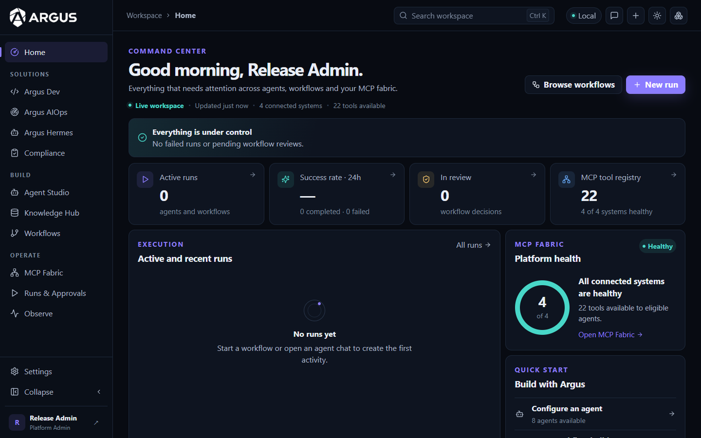
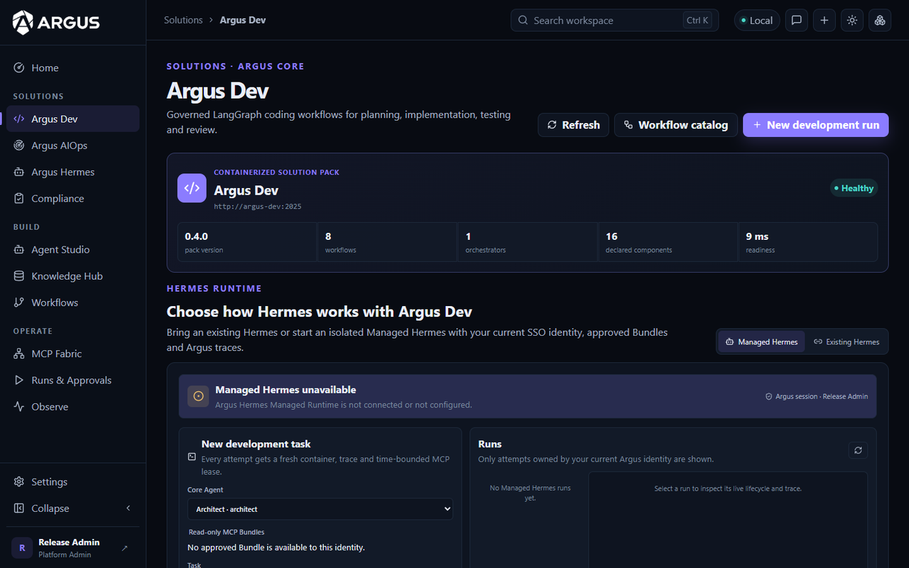
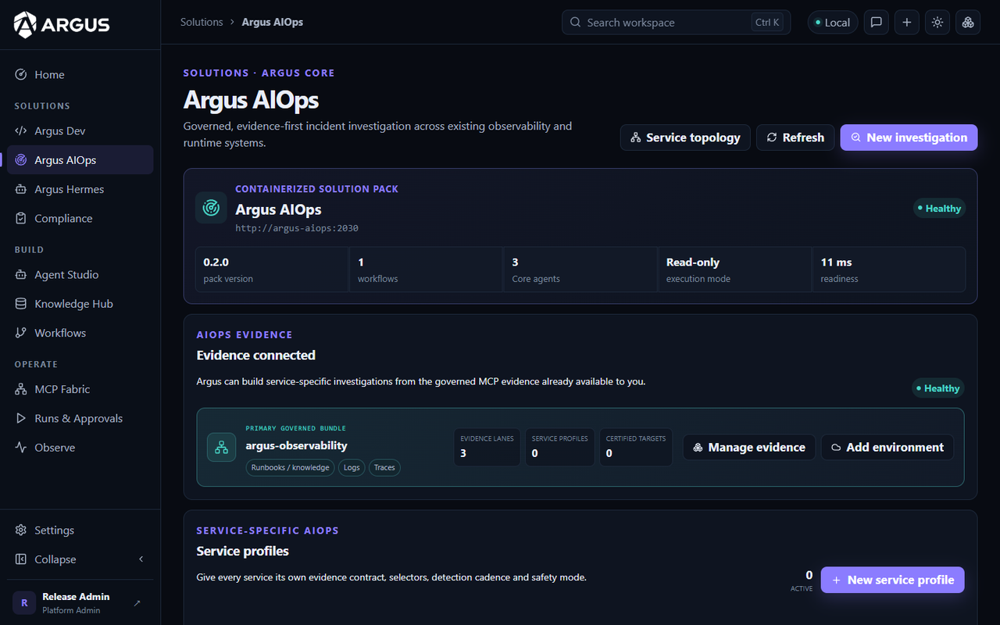
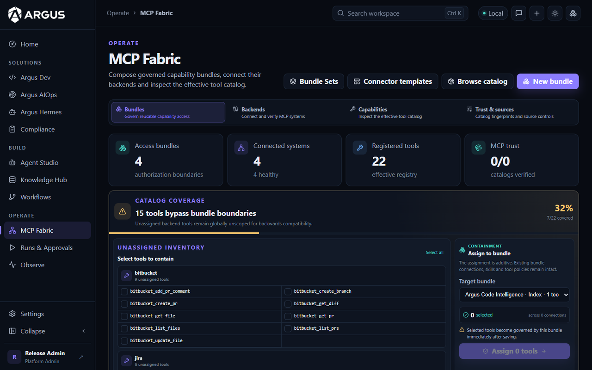
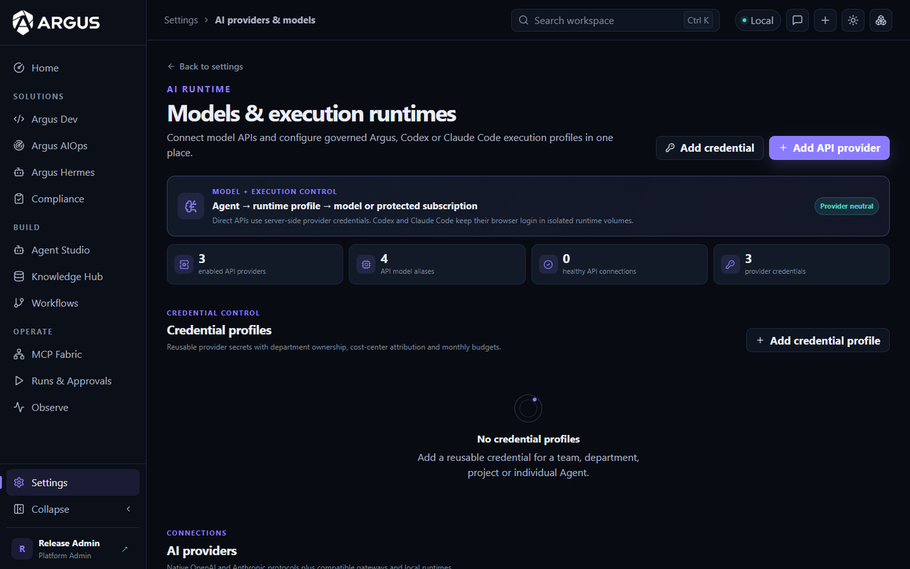
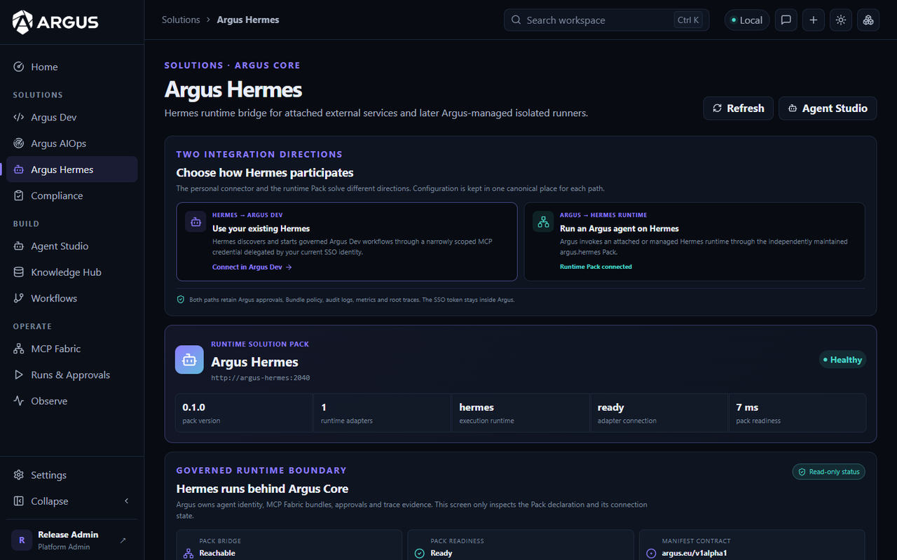

<div align="center">

<picture>
  <source media="(prefers-color-scheme: dark)" srcset="docs/assets/argus-wordmark-light.png">
  
</picture>

### The governed control plane for AI agents

Identity, permissions, tools, approvals and evidence for every agent run —
self-hosted, provider-neutral and auditable.

[](LICENSE)
[](#project-status)
[](#installation)
[](tsconfig.json)
[](#mcp-fabric)
[](packs/argus-dev)

[Quick start](#quick-start) ·
[Installation](#installation) ·
[Architecture](#architecture) ·
[Solution Packs](#solution-packs) ·
[Docs](#documentation) ·
[Security](SECURITY.md) ·
[Contributing](CONTRIBUTING.md)

<br>



</div>

---

## Why Argus

AI agents now open pull requests, query production telemetry and call internal
APIs. Argus makes that controllable and provable:

- **One authority for identity and access.** Users, SSO groups, API keys and
  technical identities map to roles, tenants/workspaces and capability
  bundles. Agents never get more than the intersection of what the caller, the
  agent and the run are allowed to do.
- **Governed tool access through MCP.** Remote MCP servers and HTTP/SQL backends
  are connected once, their tool catalogs are fingerprinted and reviewed, and
  agents only see the tools of their bundles.
- **Humans stay in the loop.** Risky steps pause for approval; plans are bound
  to immutable fingerprints so what was approved is what runs.
- **Evidence by default.** Every run produces correlated traces, logs and
  hash-chained audit events with signed checkpoints and exportable evidence
  packs.
- **Bring your own models and runtimes.** OpenAI, Anthropic, OpenAI-compatible
  gateways, local models and subscription runtimes such as Codex and Claude
  Code — assigned explicitly, never silently swapped.

## What is in this repository

| Path | Component | What it does |
|---|---|---|
| `src/`, `argus-console/` | **Argus Core** | Identity, SSO/RBAC, agents, model/runtime profiles, MCP Fabric, bundles, execution grants, approvals, audit, traces and the Console |
| `agent-workspace/` | **Agent Workspace** | Isolated workspace sidecar for repository checkouts, tests and code changes |
| `workflow-builder/` | **Visual workflow builder** | Canvas for governed workflows with the Workflow Copilot |
| [`packs/argus-dev/`](packs/argus-dev) | **Argus Dev** | LangGraph workflows: ticket → plan → code → tests → review → approval → pull request → CI |
| [`packs/argus-aiops/`](packs/argus-aiops) | **Argus AIOps** | Read-only incident investigation across metrics, logs, traces and runtime topology |
| [`packs/argus-hermes/`](packs/argus-hermes) | **Argus Hermes** | Bridge to attached or managed Hermes agent runtimes with scoped MCP leases |

## Screenshots

<table>
  <tr>
    <td width="50%"><br><sub><b>Argus Dev</b> — governed LangGraph development workflows</sub></td>
    <td width="50%"><br><sub><b>Argus AIOps</b> — evidence-first incident investigation</sub></td>
  </tr>
  <tr>
    <td width="50%"><br><sub><b>MCP Fabric</b> — bundles, backends and tool catalog trust</sub></td>
    <td width="50%"><br><sub><b>Models &amp; runtimes</b> — providers, credentials, Codex and Claude Code</sub></td>
  </tr>
  <tr>
    <td width="50%"><br><sub><b>Argus Hermes</b> — governed agent runtime bridge</sub></td>
    <td width="50%"><br><sub><b>Command center</b> — runs, approvals and platform health</sub></td>
  </tr>
</table>

<sub>Screenshots show a fresh installation without personal data.</sub>

## Quick start

You need **Docker** (Desktop or Engine, Compose v2) and **Git**. One command
builds and starts Core, the Agent Workspace and all three Solution Packs:

```bash
git clone <this repository> argus
cd argus
docker compose -f compose.install.yml run --rm --build install
```

Open **<http://localhost:3000>** — the first account you register becomes the
platform administrator. Then connect a model provider or a Codex / Claude Code
runtime under **Settings → Providers & Models**.

## Installation

### Option 1 — One-command Docker installer (recommended)

The disposable installer container generates machine-local random secrets,
builds the selected components, starts the stack, waits for health checks and
runs the platform doctor. It never stores credentials in an image.

| Profile | Command | Includes | Docker memory |
|---|---|---|---|
| **optimal** (default) | `docker compose -f compose.install.yml run --rm --build install` | Core, PostgreSQL/pgvector, Redis, Agent Workspace, Argus Dev, Argus AIOps, Argus Hermes | 12 GiB+ |
| **minimal** | `… install minimal` | Core, PostgreSQL/pgvector, Redis | ~4 GiB |
| **everything** | `… install everything` | optimal + local Ollama/LiteLLM models, Presidio PII analysis, public-widget demo | 16 GiB+ |

Useful installer options:

```bash
# Show what would happen, change nothing
docker compose -f compose.install.yml run --rm --build install optimal --dry-run

# Restart without rebuilding existing images
docker compose -f compose.install.yml run --rm install optimal --no-build

# Run an isolated second stack under its own Compose project name
ARGUS_COMPOSE_PROJECT=argus-staging docker compose -f compose.install.yml run --rm --build install minimal
```

Update later with `git pull --ff-only` and the same installer command;
database migrations run automatically when Core starts.

### Option 2 — Manual Docker Compose

For full control over configuration, run Compose yourself:

```bash
cp .env.example .env
# Replace every CHANGE_ME / placeholder value, at minimum:
#   SESSION_SECRET, DB_ENCRYPTION_KEY, MCP_API_KEYS, POSTGRES_PASSWORD, WORKSPACE_SECRET
#   (generate each with: openssl rand -hex 32)

# Core only (PostgreSQL and Redis start as dependencies)
docker compose up -d --build mcp-server

# Core + Solution Packs
docker build -t argus-dev:local packs/argus-dev
docker build -t argus-aiops:local packs/argus-aiops
docker build -t argus-hermes:local packs/argus-hermes
docker compose -f docker-compose.yml -f compose.external-pack.yml \
  -f compose.hermes-attached.yml -f compose.hermes-local.yml up -d --build
```

Signed audit evidence needs a local Ed25519 key (`npm run setup:audit-signing-key`)
and the `compose.audit-evidence.yml` overlay; the Docker installer does this for
you. See [docs/INSTALLATION.md](docs/INSTALLATION.md).

### Option 3 — Development from source

```bash
npm ci
npm run build
docker compose up -d postgres redis   # backing services
npm run dev                           # Core with hot reload on :3000
(cd argus-console && npm ci && npm run dev)
```

`POSTGRES_CONNECTION_URL` in `.env` points at `localhost` for this mode.

### Connect SSO

Interactive OIDC (Keycloak, Okta, Auth0, …) and Microsoft Entra ID are
supported with PKCE, signed state, browser binding and MFA step-up. Guides:
[OIDC](docs/oidc-sso-setup.md) · [Entra ID](docs/entra-sso-setup.md).

### Stop and remove

```bash
docker compose stop            # stop containers
docker compose down            # remove containers, keep data
```

For the pack profiles add the same `-f compose.external-pack.yml …` files.
`docker compose down --volumes` also deletes all data.

## Architecture

```text
Users · CI · agent clients (MCP)
              │
              ▼
┌───────────────────────── Argus Core ─────────────────────────┐
│ Console · REST API · MCP gateway · agent runner · RAG         │
│ identity · RBAC · model/runtime profiles · credential refs    │
│ bundles · execution grants · approvals · audit · traces/logs  │
└──────────────┬─────────────────────────────┬──────────────────┘
               │ signed A2A execution grant  │ governed MCP / HTTP
   ┌───────────▼────────────┐       ┌────────▼───────────────────┐
   │ packs/argus-dev        │       │ Git · CI · Prometheus · Loki│
   │ packs/argus-aiops      │       │ Jaeger · Kubernetes · RAG   │
   │ packs/argus-hermes     │       │ any MCP server or HTTP API  │
   └────────────────────────┘       └─────────────────────────────┘
```

**Core owns** identity, roles, agents, model assignments, credentials, MCP
bundles, execution grants, approvals and audit. **A Solution Pack owns** its
workflow and state machine — and nothing else. Tool access is evaluated at
execution time as the intersection of:

```text
principal scope ∩ API-key policy ∩ agent bundles ∩ execution grant
                ∩ backend trust ∩ bundle tool allowlist
```

Details: [Architecture](docs/ARCHITECTURE.md) ·
[Core and Solution Packs](docs/ARGUS_CORE_AND_SOLUTION_PACKS.md) ·
[Threat model](docs/THREAT_MODEL.md).

## Features

### MCP Fabric

- Connect remote MCP servers and HTTP/SQL backends; tool catalogs are
  fingerprinted, and changed catalogs are blocked until reviewed.
- Group tools into bundles and grant bundles to agents, users, groups and API
  keys. Endpoints: `POST /mcp`, `POST /mcp/group/:bundleName`,
  `POST /mcp/:backendName`.
- MCP sessions are bound to the credential and policy that created them.

### Agents, models and runtimes

- Agents in chat, worker and reviewer modes with Core-managed model or runtime
  profiles; credential profiles per team, project or agent.
- Codex and Claude Code subscription runtimes run in isolated runtime volumes.
- Provider-neutral RAG with pgvector by default.

### Governance and evidence

- Human approval gates with immutable plan hashes.
- Hash-chained canonical audit events, Ed25519-signed checkpoints, evidence
  packs, scheduled audit reports and optional WORM anchoring.
- Fresh-MFA requirement for evidence exports; RBAC with six roles and
  tenant/workspace scopes.
- Building blocks that support AI-Act readiness work — not a certification.

### Observability

- Native traces and logs correlated across Core, agents and packs; alerts,
  incidents and remediation plans with post-change checks.

## Solution Packs

| Pack | Highlights |
|---|---|
| [**Argus Dev**](packs/argus-dev) | Durable LangGraph workflows with checkpoints, independent review, human approval, pull-request creation and CI evidence for Gitea, GitHub, GitLab, Bitbucket and Jenkins |
| [**Argus AIOps**](packs/argus-aiops) | Read-only investigation across Prometheus, Loki, Jaeger, OpenSearch and Kubernetes; reviewer-validated incident records; remediation only through Core approvals |
| [**Argus Hermes**](packs/argus-hermes) | Run Argus agents on attached or managed Hermes runtimes behind Core identity, bundles, approvals and traces |

Packs are discovered through `ARGUS_SOLUTION_PACK_ENDPOINTS`, publish an
`argus.eu/v1alpha1` manifest and an A2A agent card, and receive short-lived
signed execution grants from Core.

## Documentation

| Topic | Document |
|---|---|
| Installation and profiles | [docs/INSTALLATION.md](docs/INSTALLATION.md) |
| Architecture | [docs/ARCHITECTURE.md](docs/ARCHITECTURE.md) |
| Core and Solution Packs | [docs/ARGUS_CORE_AND_SOLUTION_PACKS.md](docs/ARGUS_CORE_AND_SOLUTION_PACKS.md) |
| Security model and reporting | [SECURITY.md](SECURITY.md) · [docs/THREAT_MODEL.md](docs/THREAT_MODEL.md) |
| SSO | [OIDC](docs/oidc-sso-setup.md) · [Entra ID](docs/entra-sso-setup.md) · [RBAC policies](docs/user-policy-rbac.md) |
| Runtimes | [Codex](docs/codex-subscription-runtime.md) · [Claude Code](docs/claude-subscription-runtime.md) |
| Governance | [docs/GOVERNANCE.md](docs/GOVERNANCE.md) · [AI-Act documentation template](docs/eu-ai-act-technical-documentation.md) |
| Operations | [Platform readiness](docs/PLATFORM_READINESS.md) · [Incident response](docs/runbooks/incident-response.md) · [Business continuity](docs/BCP.md) |
| API contracts | [docs/specs/](docs/specs/) · OpenAPI at `/docs` on a running instance |

## Development

```bash
npm ci && npm run build
npm test                               # Core Jest suite
npm run test:scripts                   # scripts/*.test.mjs
(cd argus-console && npm ci && npm test)
(cd packs/argus-dev && npm ci && npm test)
(cd packs/argus-aiops && npm ci && npm test)
(cd packs/argus-hermes && npm ci && npm test)
```

Integration suites that need PostgreSQL are skipped unless
`POSTGRES_CONNECTION_URL` is set. See [CONTRIBUTING.md](CONTRIBUTING.md).

## Project status

Argus is **early, pre-1.0** software. Interfaces, database schema and
configuration can change between commits. It is not presented as a certified
security, compliance or autonomous production-remediation product; whether a
deployment meets a regulatory requirement depends on its purpose,
configuration and operating process. Known limitations are listed in
[SECURITY.md](SECURITY.md).

## Contributing and security

Contributions are welcome — please open an issue first for larger changes and
sign off your commits ([CONTRIBUTING.md](CONTRIBUTING.md)). Report
vulnerabilities privately as described in [SECURITY.md](SECURITY.md). Contact:
<hello.argus@proton.me>.

## License

Argus is free software under the
[GNU Affero General Public License v3.0](LICENSE) (`AGPL-3.0-only`). If you run
a modified version of Argus as a network service, the AGPL requires you to
offer the corresponding source code of your modifications to its users.

`workflow-builder/` is derived from Sim Studio and keeps its Apache-2.0 license
and notices; other third-party components keep their own licenses (see
[NOTICE](NOTICE)). Logos of integrated products under
`argus-console/public/brand/` are trademarks of their respective owners and do
not imply endorsement.
